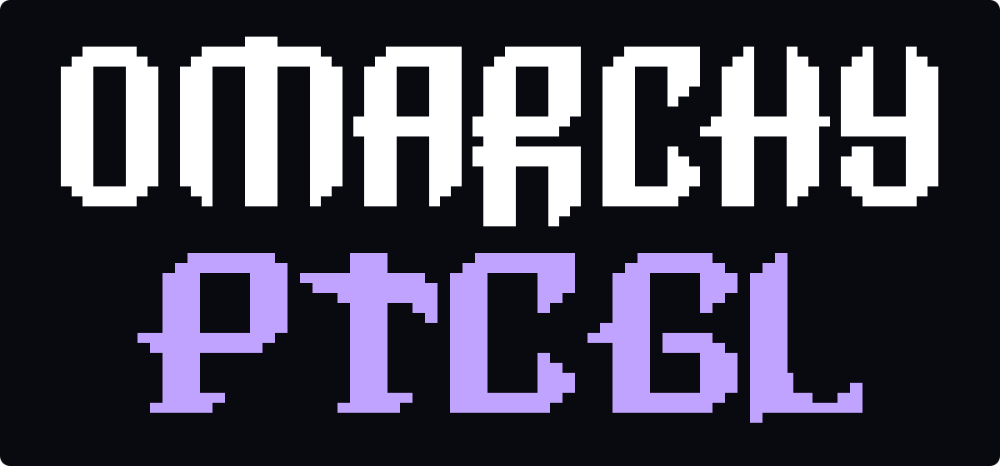

<p align="center">
  
</p>

<p align="center">
  <strong>Pokémon TCG Live. Tiled, resized, and right at home on Omarchy.</strong>
</p>

<p align="center">
  <a href="https://github.com/hucKOder/omarchy-ptcgl/actions/workflows/ci.yml"></a>
  <a href="https://omarchy.org"></a>
  <a href="LICENSE"></a>
</p>

<p align="center">
  <a href="#install">Install</a> ·
  <a href="#demo">Watch the demo</a> ·
  <a href="#updates">Updates</a> ·
  <a href="#development">Development</a>
</p>

## A proper desktop window

Play the official Pokémon TCG Live client alongside your editor, terminal, and
everything else. Launch from Omarchy's app menu, resize its tile, move between
workspaces, and use your usual window shortcuts.

**Omarchy PTCGL** is a small Go installer and launcher. It runs the Windows game
through **UMU + GE-Proton + XWayland**, with the desktop details handled for you:

- **Tiled from the start.** Windowed startup and game-specific Hyprland rules
  handle Wine's fixed-size hints. `Super + F` still toggles compositor fullscreen.
- **Launch once, focus again.** Reopening the app focuses the existing game.
- **Sign in through your browser.** The login callback returns to the running game.
- **Keep your own game environment.** A dedicated prefix and pinned Proton build.
- **Update on your terms.** Game patches, installer updates, and Proton upgrades
  have separate paths.

After first-time setup, the app-menu entry opens straight into the game.

## Demo

https://github.com/user-attachments/assets/5066d5b3-5bf4-4150-998e-15bc940236e6

*Recorded on Omarchy: Pokémon TCG Live sharing the desktop with an editor and
terminals while the layout changes.*

[Open the recording](https://github.com/hucKOder/omarchy-ptcgl/raw/refs/heads/main/docs/assets/tiling-demo.mp4)
· [View a still frame](docs/assets/tiling-demo.webp)

## Install

You need **x86-64 Omarchy**, its **Lua Hyprland configuration** (Hyprland 0.55+),
working XWayland and Vulkan, and approximately **8 GB of free space**. Close the
game before installing or upgrading the launcher.

1. Prepare the bootstrap tools: `omarchy pkg add github-cli curl jq coreutils`.
   GitHub CLI 2.102.0 is tested; the installation block checks its required
   attestation-verification capabilities. No GitHub login is needed.
2. Make **`osslsigncode`** available using
   [the verifier provisioning guide](docs/AUR-DEPENDENCIES.md). It verifies the
   official game's installer signature and publisher. A supported binary package
   route is still being investigated; this prerequisite currently needs separate
   provisioning, including for `--launcher-only`.
3. [Choose a published release](https://github.com/hucKOder/omarchy-ptcgl/releases)
   and copy its complete **Install** block into Bash as your regular desktop
   user. Releases built from this checkout include the selected version and source
   commit in that block. For **v0.2.0**, which predates those generated instructions,
   use [the ready-to-run v0.2.0 procedure](docs/RELEASES.md#verified-release-installation).

**The complete block verifies and runs the installer. There is no second
`install.sh` command to run afterward.** It authenticates the installer before
executing it, then authenticates the release metadata and launcher before making
installation changes. The installer:

- Installs repository dependencies through `omarchy pkg add`.
- Uses Omarchy's gaming helper to install the appropriate 32-bit GPU drivers.
- Uses the selected prebuilt launcher, verified against its attested manifest.
- Adds **Pokémon TCG Live (Omarchy)** to the app launcher, registers browser
  login, and installs the tiled-window rules.
- Prepares Proton and installs the official Pokémon client, verifying the MSI's
  signature and publisher. This first setup can take a while.

Omarchy requests your sudo password for system packages when needed. The main
Hyprland config is backed up before its loader block is added, and live rule
changes are validated.

The installed executable is `~/.local/bin/ptcgl-omarchy`.

### Play

Open **Pokémon TCG Live (Omarchy)** from the app menu, or run:

```bash
ptcgl-omarchy
```

Sign in using your normal browser when the game asks. If a download or runtime
setup is interrupted after the launcher is installed, run `ptcgl-omarchy setup`
to retry. If Windows Installer failed or was interrupted, run
`ptcgl-omarchy repair`. See [the recovery guide](docs/UPDATES.md#interrupted-operations).

<details>
<summary><strong>Install only the launcher, or install from a checkout</strong></summary>

To leave the game download for the first app-menu launch, append `--launcher-only`
to the final `bash` command inside the selected release's complete installation
block. Run that whole block, including its verification steps.

To build and install a local checkout, including dependencies and game setup:

```bash
git clone https://github.com/hucKOder/omarchy-ptcgl.git
cd omarchy-ptcgl
git checkout --detach FULL_40_HEX_COMMIT
# Review the selected source before executing it.
bash ./install.sh --local
```

Replace `FULL_40_HEX_COMMIT` with the source revision you intend to build.
`make install` runs the explicit local installation flow. Local builds need Go 1.24+
and Make; the installer adds them through Omarchy when needed.

Prefer the terminal? Setup and launch are also available separately:

```bash
ptcgl-omarchy setup
ptcgl-omarchy play
```

</details>

### Open folders

The folder shortcuts, expanded diagnostic fixes, and maintenance result dialogs
described below require v0.3.0 or later.

Use the **Open folders** desktop action to choose the game installation,
launcher configuration, or download cache, or open a folder directly:

```bash
ptcgl-omarchy open game
ptcgl-omarchy open config
ptcgl-omarchy open cache
ptcgl-omarchy open --gui
```

Folders open in your default file manager using the active XDG paths. These
shortcuts work while the game is running and even when launcher configuration
needs fixing. A missing folder is explained with its location; the configuration
folder is optional until you add `config.json`.

## Updates

**Game patches happen at launch.** The client runs from its installation
directory so its built-in updater can apply patches correctly.

**Official installer updates are explicit.** Close the game, then run:

```bash
ptcgl-omarchy update
```

An unchanged MSI is skipped. Updates and repairs use the existing prefix;
maintenance is blocked while the launcher-managed game session is running.
To inspect the installer without applying it, optionally run
`ptcgl-omarchy update --check`. It compares the official MSI, not the game's
in-client patch state; checking first is not required for `update`.

The app's desktop actions include **Check installer updates**, **Update game**,
**Repair game**, and **Diagnostics**. Graphical checks, updates, and repairs show
operation-specific progress and a result dialog explaining whether the installer
was unchanged, an update is available, or the update/repair completed. These
maintenance actions require the game to be closed.

**Launcher and Proton updates are separate.** Close the game and choose a release.
Repeat its complete verified installation block, appending `--launcher-only` to
the final `bash` command. The version and source commit stay pinned to that
release's published selection.

Missing releases, invalid attestations, or mismatched hashes stop installation.
The installer never falls back to building `main`.

Your selected Proton profile is retained. To explicitly select the profile
bundled with the new launcher release:

```bash
ptcgl-omarchy runtime-update
```

Previous managed runtime versions remain available for troubleshooting.
See [the update guide](docs/UPDATES.md) for repair, interrupted operations, and
runtime rollback behavior.

## Commands

| Command | What it does |
| --- | --- |
| `ptcgl-omarchy` | Graphical first-time setup, then play |
| `play [-- <args>]` | Launch the game or focus its existing window |
| `setup [--gui]` | Prepare the selected runtime and install missing game files |
| `update [--check] [--gui]` | Check or apply the current official installer |
| `repair [--gui]` | Reapply installer-managed game files |
| `runtime-update [--gui]` | Select this launcher's bundled compatibility profile |
| `doctor [--json\|--gui]` | Check dependencies, game installation, and desktop integration |
| `open <game\|config\|cache>` | Open the selected folder in your default file manager |
| `open --gui` | Choose a folder graphically |
| `integrate` | Refresh the app-menu entry, browser callback, and window rules |
| `uninstall` | Remove the launcher and integration; retain installed game data |

Commands in the table are subcommands of `ptcgl-omarchy`, except for the first row.

## Troubleshooting

Start with:

```bash
ptcgl-omarchy doctor
```

Failed checks show the reason and a **Fix** line with a recovery command or
instructions. Reports distinguish missing setup, incomplete/custom Proton
runtimes, missing desktop entries, incorrect browser handlers, and Hyprland
configuration errors. The app-menu **Diagnostics** action shows the same guidance.

For scripts, `ptcgl-omarchy doctor --json` includes `name`, `ok`, and `detail` for
each check, plus `fix` for failures. The command exits with status 1 if any check
fails.

- **Login opens another installation:** run `ptcgl-omarchy integrate` to select
  this launcher's browser callback handler.
- **Installer-managed game files need repair:** close the game and run
  `ptcgl-omarchy repair`.
- **A game update changes window behavior:** the Lua rules match the game's
  title and XWayland, rather than every game using `steam_app_0`. Inspect the
  game window with `hyprctl clients -j` and check `hyprctl configerrors`.
- **Maintenance reports a running session:** close the game before setup,
  update, repair, integration changes, uninstall, or runtime changes.

Setup and update output is available when run from a terminal. Login callback
arguments and callback subprocess output are not persisted by the launcher.
Unity Player logging is disabled because the current game writes login callback
URLs to its own log.

## Configuration

<details>
<summary><strong>Paths and optional launch overrides</strong></summary>

The launcher honors `XDG_DATA_HOME`, `XDG_CACHE_HOME`, `XDG_CONFIG_HOME`, and
`XDG_STATE_HOME`. Default locations:

```text
~/.local/share/ptcgl-omarchy/prefix/       Game, registry, settings, login state
~/.local/share/ptcgl-omarchy/runtime/      Managed GE-Proton versions
~/.cache/ptcgl-omarchy/                   MSI and Proton download cache
~/.config/ptcgl-omarchy/config.json       Optional user overrides
~/.local/state/ptcgl-omarchy/             Runtime profile and installation receipts
~/.config/hypr/ptcgl-omarchy.lua          Game-specific window rules
```

Example `config.json`:

```json
{
  "proton_path": "/absolute/path/to/GE-Proton",
  "extra_args": ["-screen-width", "1280", "-screen-height", "720"]
}
```

Omit `proton_path` to use the managed runtime. Custom runtimes are validated,
but maintained by you rather than by `runtime-update`.

</details>

## Development

The launcher uses Go's standard library. Build and verify it with:

```bash
make check
make test
make build
```

With dependencies already installed, `make install-launcher` installs your local
build and refreshes desktop integration without running game setup.

Version tags trigger the release workflow, which runs the checks, generates
release-specific installation instructions, and publishes the attested installer,
manifest, and Linux x86-64 launcher. Release installation needs neither Go nor
Make nor a repository clone.

Tests cover the release installer, generated bootstrap instructions, verified
downloads, archive extraction, update locking, prefix preservation, callback
delivery, runtime selection, and integration recovery.
Real graphics, browser authentication, in-game patching, and gameplay also need
manual validation on Omarchy.

- [Implementation plan](docs/PLAN.md)
- [Installation simplification plan](docs/INSTALLATION-PLAN.md)
- [Game and runtime update behavior](docs/UPDATES.md)
- [Real-machine validation record](docs/VALIDATION.md)
- [Compatibility profile](internal/app/assets/compatibility.json)
- [Report an issue](https://github.com/hucKOder/omarchy-ptcgl/issues)

## Credits

Built for [Omarchy](https://omarchy.org), using
[UMU](https://github.com/Open-Wine-Components/umu-launcher) and
[GE-Proton](https://github.com/GloriousEggroll/proton-ge-custom).

The initial compatibility profile, updater working-directory requirement, and
browser callback behavior were researched using
[PTCGL-Linux](https://github.com/mattmcbeardface/ptcgl-linux). This is an
independently implemented Go launcher.

## License

[MIT](LICENSE). The official Pokémon client and compatibility runtimes are
downloaded during setup rather than distributed in this repository.

An unofficial community project for Omarchy. Not affiliated with the Omarchy
project or The Pokémon Company.
